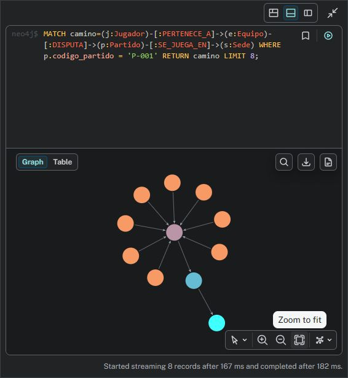

# Walkthrough — correcciones a partir de la devolución del profesor

Revisión del 19/10/2026, rama `hito-11`, base `c55b302`. Todos los cambios quedan locales:
**sin staging, commit ni push**. Este documento explica la revisión docente posterior a las
correcciones previas de conectividad. Los hitos 1, 2 y 3 se excluyeron por indicación del usuario:
sus entregas están en Google Drive y el grupo las revisará por separado.

## Resultado y límite pendiente

Se corrigieron los puntos pendientes de los hitos 4 a 10 y se mantuvo compatible el Hito 11.
En el Hito 4 la mayor parte de la reducción de alcance ya estaba hecha. Las verificaciones
actuales tienen evidencia nueva y se distinguen de los resultados históricos.

**InfluxDB: token verificado el 23/10/2026.** La corrida del 19/10 se hizo en una notebook
sin el archivo `.influxdb3-token`, por eso InfluxDB figuraba como no configurado. En la notebook
que tiene el token se comprobó que el servidor lo acepta. El diagnóstico del Hito 11 dio
14 OK y 0 FAIL, y la API leyó estadísticas con 200. No se borraron datos ni se regeneró el token.
El detalle está en la sección del Hito 8.

## Hito 4 — alcance documental

El módulo ya se limita a equipos y jugadores, validaciones, índices, consultas y `explain()`.
No encontré en su código/documentación las claves de distribución, mecanismos internos,
estadísticas, salud o goleadores cuestionados por el profesor.

En [las decisiones documentales](../fixture2030-mongoDB/docs/Grupo_4_Hito_4_Decisiones_Documentales_Fixture2030.md)
quité una garantía de tiempo que no estaba respaldada por esa decisión y corregí la explicación
de los datos relacionados. No agregué funciones ni pruebas artificiales por este ajuste de texto.
La lectura real de MongoDB desde la API devuelve la selección correctamente.

## Hito 5 — evidencia real del grafo

Se incorporó la carpeta prometida de evidencia. Ejecuté las restricciones y la carga desde
los JSON versionados del Hito 4; volví a ejecutar la carga y comparé nodos y relaciones.
Ambas ejecuciones dejaron **1.542 nodos y 1.480 relaciones**: 64 equipos, 1.472 jugadores,
2 partidos, 3 sedes y 1 evento. La segunda carga no creó duplicados.

Para demostrar CRUD sin borrar un evento de otra persona, cambié el identificador del ejemplo
de `EV-002` a **`EV-H5-DEMO`**. El generador comprueba que no exista antes de empezar.
La ejecución creó la tarjeta al minuto 45, la leyó con su jugador y partido, cambió el minuto
a 47 y eliminó ese mismo evento de prueba. Al final no queda ningún nodo con ese identificador.

Ejecuté además los tres recorridos: rivales, jugadores por sede y agrupación de sedes; devolvieron
2, 15 y 2 filas respectivamente. Abrí Neo4j Browser, conecté al servidor local y ejecuté un
recorrido de tres saltos. El Browser informó 11 nodos y 10 relaciones para ocho caminos.

Archivos para revisar:

- [Evidencia y explicación](../fixture2030-neo4j/docs/evidencia/revision_2026-10-19/README.md).
- [Consultas, resultados y contadores](../fixture2030-neo4j/docs/evidencia/revision_2026-10-19/ejecucion.json).
- [Generador portable](../fixture2030-neo4j/tools/generar_evidencia.py), ejecutado también para comprobar su reproducibilidad.

La carga vuelve a escribir los atributos de las muestras con los mismos identificadores;
no debe ejecutarse para conservar modificaciones manuales hechas sobre esas mismas muestras.
Los tiempos puntuales no son una garantía de rendimiento del escenario completo.

## Hito 6 — volumen nombrado de Cassandra

Compose raíz y Compose independiente ahora montan **`fixture2030_cassandra_data`** en
`/var/lib/cassandra`, cumpliendo RNF2. Actualicé las instrucciones para que no indiquen que
el directorio del host sigue siendo el almacenamiento activo.

La corrección también se aplicó al contenedor existente, sin empezar con una base vacía:

1. Detuve únicamente Cassandra para obtener una copia consistente.
2. Copié los datos del bind mount anterior al volumen nombrado vacío.
3. Comparé SHA-256 de **147 archivos**: todos coincidieron.
4. Recreé solo ese servicio con la imagen instalada y esperé el estado saludable.
5. Conservé intacto el directorio original como respaldo.

El script contempla volver al montaje original si la recreación falla. No borra el origen.
La [evidencia de migración](../fixture2030-cassandra/docs/revision_2026-10-19/migracion_volumen.json)
registra volumen, imagen, cantidad de archivos y coincidencia de hashes.

Este laboratorio no tenía el keyspace `fixture2030`; después de migrar ejecuté los tres scripts
idempotentes de esquema y muestra, que cargaron 35 comentarios. La API ya lee esa muestra.
No volví a ejecutar la carga histórica superior a un millón ni atribuí sus tiempos al volumen nuevo.
Ver [procedimiento de migración](../fixture2030-cassandra/docs/revision_2026-10-19/README.md).

## Hito 7 — distinguir sesiones de caché

El problema era conceptual y operativo: `volatile-lru` puede expulsar cualquier clave con TTL,
incluidas sesiones todavía activas. Tener vencimiento no significa que un dato pueda descartarse
antes de ese momento. Una ficha de caché se reconstruye desde su fuente; una sesión representa
estado de acceso y no debe tratarse como esa copia.

Elegí **`noeviction`** para la única instancia del laboratorio, conservando los TTL de sesiones.
Los dos Compose y el script de inicialización coinciden. Lo apliqué a la instancia activa mediante
`CONFIG SET`, sin reiniciarla. Una clave temporal propia conservó un TTL positivo y se eliminó
al terminar la comprobación.

El costo queda explícito: con memoria agotada, pueden fallar nuevas sesiones, renovaciones
o escrituras de caché. Hay que comunicar esos errores y vigilar memoria; no se promete acceso
infinito. Las claves todavía vencen según su TTL. No llené deliberadamente de memoria una
instancia compartida para simular OOM ni afirmo haber ejecutado esa prueba.

Ver [justificación corregida](../fixture2030-redis/docs/memoria_y_escalabilidad.md) y
[configuración observada](../fixture2030-redis/docs/revision_2026-10-19/politica.json).

## Hito 8 — entorno de InfluxDB reproducible

El Compose del módulo usaba una etiqueta distinta de la documentada. Ambos Compose ahora
usan **`influxdb:3-core`**, con los mismos parámetros del servicio. También alineé la publicación
local del puerto y el directorio persistente. Recreé únicamente InfluxDB con la imagen ya instalada,
conservando sus datos.

El verificador contrasta ambos Compose, verifica imagen y comando del contenedor y registra
versión, digest, montajes, puertos y hashes de los archivos. La imagen local reporta **3.12.0**.
La etiqueta `3-core` puede avanzar; el digest guardado identifica exactamente este binario.

Corregí además la inicialización para no guardar un token vacío, ocultar errores de creación
o declarar éxito solamente porque el CLI terminó con código cero. Se comprueba autorización
HTTP y existencia de la base. No ejecuté una inicialización destructiva sobre el servidor existente.

El 23/10 se unificó todo en el [README del Hito 8](../fixture2030-influxDB/README.md) y se quitó la
carpeta `revision_2026-10-19`. Ahora `verificar_entorno.py` también prueba el token, sin guardarlo,
y sobrescribe un único [`08_entorno.json`](../fixture2030-influxDB/docs/evidencia/08_entorno.json).
Resultados: 401 sin token, 200 con el token y base `fixture2030` presente. El diagnóstico del Hito 11
dio 14 OK y 0 FAIL ([`09_conectividad.txt`](../fixture2030-influxDB/docs/evidencia/09_conectividad.txt)).
La carga de 10M puntos del 07/10 sigue presentada como evidencia histórica y no se repitió.

## Hito 9 — objetos, guardado y una regla de dominio

Conservé las cinco clases del modelo, propiedades tipadas/obligatorias, herencia y relación
padre-hijo. Quité listas de valores, límites de rango, el callback de guardado y el recorrido
mediante `%ResultSet`. La proyección SQL se demuestra con SELECT y `%SQL.Statement.%ExecDirect`.

La única regla de dominio quedó en **`Partido.AgregarEvento`**: si el estado es Finalizado,
rechaza el nuevo evento; en otro caso crea el hijo, lo asocia y guarda el conjunto. El ejemplo
enseña a usar ese método. No pretende impedir escrituras externas por cualquier otra vía.

Antes de compilar exporté las definiciones instaladas como respaldo local. Las cinco clases
y la rutina compilaron correctamente. La demostración real:

- Guardó árbitro y técnico, evidenciando la herencia.
- Guardó P-009 con dos hijos mediante un `%Save()` del padre.
- Reabrió y navegó árbitro, eventos y referencia inversa al padre.
- Mostró la misma información mediante SQL.
- Rechazó un partido sin Sede por propiedad obligatoria.
- Guardó Finalizado y rechazó un evento nuevo: **antes=2, después=2**, `REGLA_OK`.

La rutina conserva P-009 si ya existe en una segunda ejecución. No reinicia actas ajenas.
[Salida de compilación y demostración](../fixture2030-iris/docs/revision_2026-10-19/compilacion_y_demo.txt)
y [modelo/documentación](../fixture2030-iris/README.md).

## Hito 10 — integración de seis motores sin ampliar el dominio

Reduje los 16 casos a **seis lecturas de negocio**, una por fuente:

| Fuente | Ruta |
|---|---|
| MongoDB | `GET /equipos/{codigo_iso}` |
| Neo4j | `GET /partidos/{codigo_partido}/eventos` |
| Cassandra | `GET /partidos/{codigo_partido}/comentarios` |
| Redis | `GET /sesiones/{id_sesion}` |
| InfluxDB | `GET /partidos/{codigo_partido}/estadisticas` |
| IRIS | `GET /partidos-oficiales/{codigo_partido}` |

Quité caché Redis sobre Neo4j, escrituras HTTP en Cassandra e IRIS, invalidación HTTP de
sesiones, reservas de idempotencia, rutas adicionales de catálogo y fachada ObjectScript.
La lectura de IRIS usa **DB-API y SQL parametrizado** sobre las clases del Hito 9.
Mantengo separación ruta → servicio → adaptador, límites, validación, errores uniformes y request ID.

Las seis lecturas se pueden repetir sin modificar datos de dominio. La respuesta puede cambiar
por datos nuevos o por vencimiento de una sesión; eso no implica que el GET esté escribiendo.
No se agrega una escritura artificial solo para demostrar conflictos o duplicación.

Reescribí la documentación de casos, arquitectura, configuración y contratos para describir
el alcance final. Regeneré OpenAPI y reduje Postman de 64 solicitudes a **10 GET esenciales**.
Las pruebas se concentran en lecturas, ausencia, validación, aislamiento entre fuentes y fallas.
Los generadores de evidencia ya no reinician actas, publican comentarios ni detienen motores.

Preparé un `.env` local ignorado por Git con las credenciales disponibles y una identidad IRIS
dedicada de lectura, sin modificar contraseñas existentes. Su rol permite leer la base y SELECT
del esquema Fixture. Los secretos no aparecen en la evidencia. En esa corrida InfluxDB no tenía
token; el 23/10 se verificó con el token del Hito 8 (ver arriba).

[Guía actual de API](../fixture2030-hito-10-api-integrada/README.md),
[OpenAPI](../fixture2030-hito-10-api-integrada/openapi/openapi.yaml) y
[evidencia de las lecturas](../fixture2030-hito-10-api-integrada/docs/evidencia/revision_2026-10-19/README.md).

## Compatibilidad con Hito 11 y validación final

Conservé liveness, readiness y diagnóstico por dependencia porque son requisitos del Hito 11.
Su reutilización temporal es del diagnóstico en memoria; no reintroduce la caché de negocio.
Quité de su evaluador las rutas de plantel/ficha eliminadas y cambié la lectura de IRIS a SQL,
con clase de contexto Fixture.Partido y acta P-009. Actualicé sondas, ejemplo de configuración
y cliente de terminal del contenedor.

Resultados finales:

- **API: 61 aprobadas, 1 omitida**: 46 unitarias, 10 de fallas/timeout con drivers reales y
  5 lecturas reales. Se omite solo InfluxDB por configuración faltante.
- **Hito 11: 42 aprobadas**. Incluyen las correcciones anteriores del evaluador y las sondas.
- **17 solicitudes por HTTP real** a un Uvicorn temporal: nueve 200, dos 400, cuatro 404
  y dos 503. Los 503 son estadísticas InfluxDB sin token; los 404 incluyen la sesión vencida.
- **Diagnóstico completo: 76 OK, 4 WARN, 2 FAIL, 9 SKIP**, salida estricta 1. Cinco motores
  disponibles e InfluxDB no configurado. Los FAIL y las capas omitidas quedan visibles.
- Compilación y demostración IRIS, generador Neo4j, sintaxis Python/Bash y revisión de espacios.
- Comprobación de archivos locales ignorados y de que las credenciales nuevas no aparecen en la evidencia.

Esos resultados son de la corrida del 19/10, sin el token. Con el token, el 23/10
`test_lectura_real[influxdb]` pasó, `GET /partidos/P-001/estadisticas` devolvió 200 y
`/health/dependencias` informó `influxdb=up`.

Las respuestas HTTP se guardaron con su request ID. El servidor temporal se detuvo al terminar.
No se usan las latencias puntuales para prometer el rendimiento del escenario de producción.
La [matriz completa](../fixture2030-hito-11-conectividad/docs/evidencia/revision_2026-10-19/feedback_completo.md)
explica cada capa y las limitaciones. La evidencia anterior se conserva rotulada como histórica.

## Qué queda en el entorno

Los cambios de código/documentación están sin commit. Cassandra usa el volumen nombrado y
conserva el directorio anterior; Redis usa noeviction; InfluxDB conserva su imagen 3.12.0 y
directorio; IRIS conserva objetos anteriores y agrega la muestra P-009. Los seis contenedores
del laboratorio continúan disponibles según sus verificaciones de proceso; eso no equivale a
tener autorización de lectura en los seis.

El punto que quedaba pendiente, el token de InfluxDB, se cerró el 23/10 (ver Hito 8).
El contenedor de InfluxDB de esa notebook se creó antes de alinear el Compose y todavía publica
el 8181 en todas las interfaces. Se corrige con `docker compose up -d --force-recreate influxdb`,
sin perder datos. Los hitos 1–3 quedan para la revisión del grupo en Google Drive, como se solicitó.
