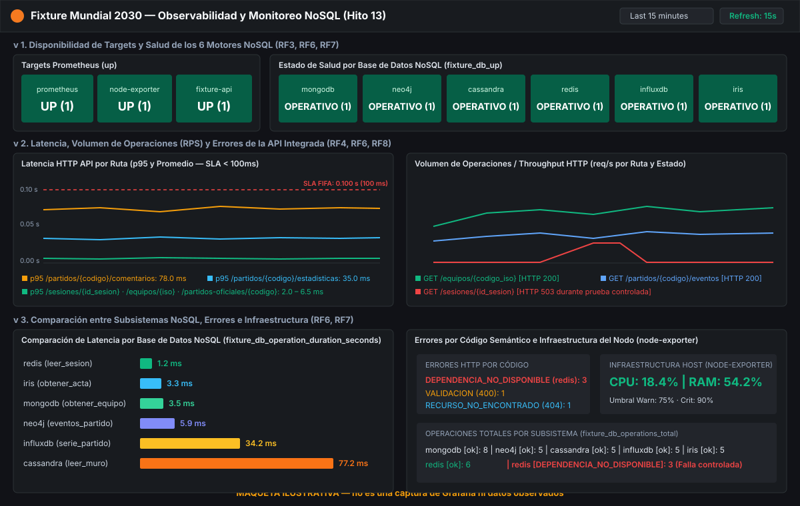

# Evidencia de Dashboards de Grafana y Prometheus — Hito 13

Esta carpeta contiene la referencia visual y trazable del dashboard **Fixture Mundial 2030 — Observabilidad y Monitoreo NoSQL (Hito 13)**:

1. **Definición exportable y reproducible de Grafana (JSON):**
   - [`../../grafana/dashboards/fixture2030_war_room.json`](../../grafana/dashboards/fixture2030_war_room.json)
2. **Maqueta de la disposición de los paneles (SVG, dibujada a mano — NO es una captura de Grafana ni contiene datos observados):**
   - [`vista_dashboard_war_room.svg`](vista_dashboard_war_room.svg)

> Las capturas reales del dashboard durante la prueba de falla se guardan en esta carpeta como `*.png` (ver [`../README.md`](../README.md)). Los valores que aparecen en la maqueta son ilustrativos.

## Qué muestra cada sección del Dashboard (RF5, RF6, RF7, RNF4)

- **Fila 1 — Disponibilidad:**
  - `Targets Prometheus (up)`: estado de `prometheus:9090`, `node-exporter:9100` y `fixture-api:8000`.
  - `Estado de Salud por Base de Datos NoSQL (fixture_db_up)`: tarjetas de estado individuales para `mongodb`, `neo4j`, `cassandra`, `redis`, `influxdb` e `iris`.
- **Fila 2 — Latencia vs. SLA (< 100ms) y Volumen (RPS):**
  - `Latencia HTTP API por Ruta`: percentil 95 (`p95`) y promedio en segundos con línea de umbral en `0.100 s` (`100 ms`).
  - `Volumen de Operaciones / Throughput HTTP`: tasa de requests por segundo (`req/s`) separada por ruta y código de estado (`200`, `400`, `404`, `503`).
- **Fila 3 — Comparación entre los 6 Motores NoSQL y Errores:**
  - `Comparación de Latencia por Base de Datos NoSQL`: permite contrastar tiempos en memoria (`redis ~1,2 ms`), lecturas puntuales indexadas (`iris ~3,3 ms`, `mongodb ~3,5 ms`, `neo4j ~5,9 ms`) y lecturas de series temporales o particiones múltiples (`influxdb ~34,2 ms`, `cassandra ~77,2 ms`).
  - `Errores de Aplicación y Dependencias` (cantidad en los últimos 5 min, `increase[5m]`): distingue rechazos de validación (`VALIDACION`) de caídas reales (`DEPENDENCIA_NO_DISPONIBLE`).
- **Fila 4 — Operaciones por Subsistema e Infraestructura (`node-exporter`):**
  - `Throughput por Base de Datos` (`rate(fixture_db_operations_total[1m])`, sin pings de salud).
  - `Infraestructura del Nodo: CPU y Memoria` (`node_cpu_seconds_total` y `node_memory_MemAvailable_bytes`).
